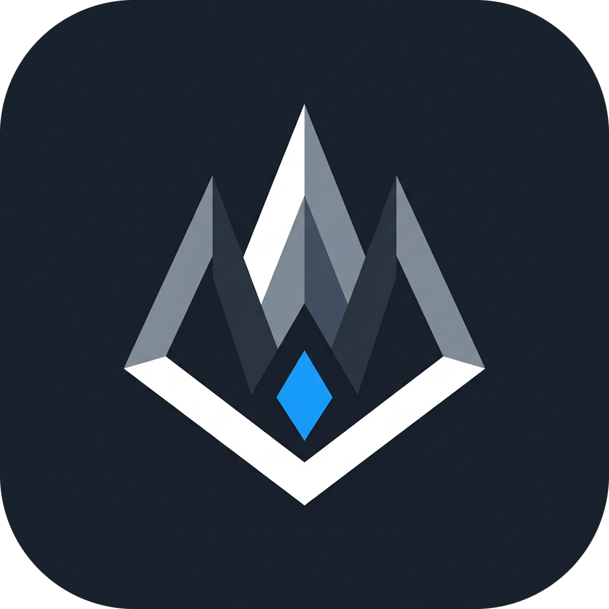
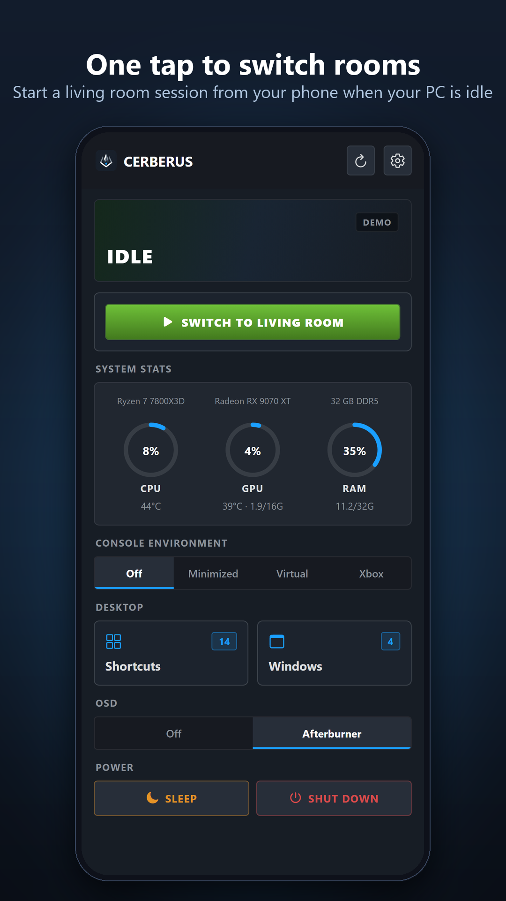
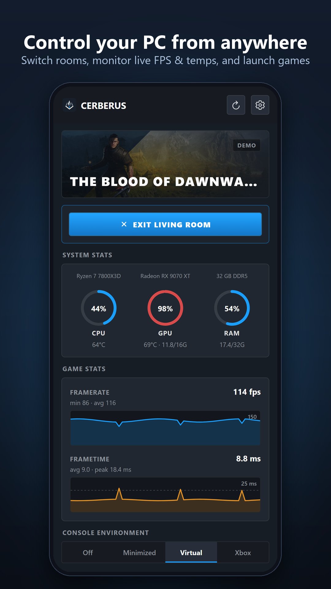
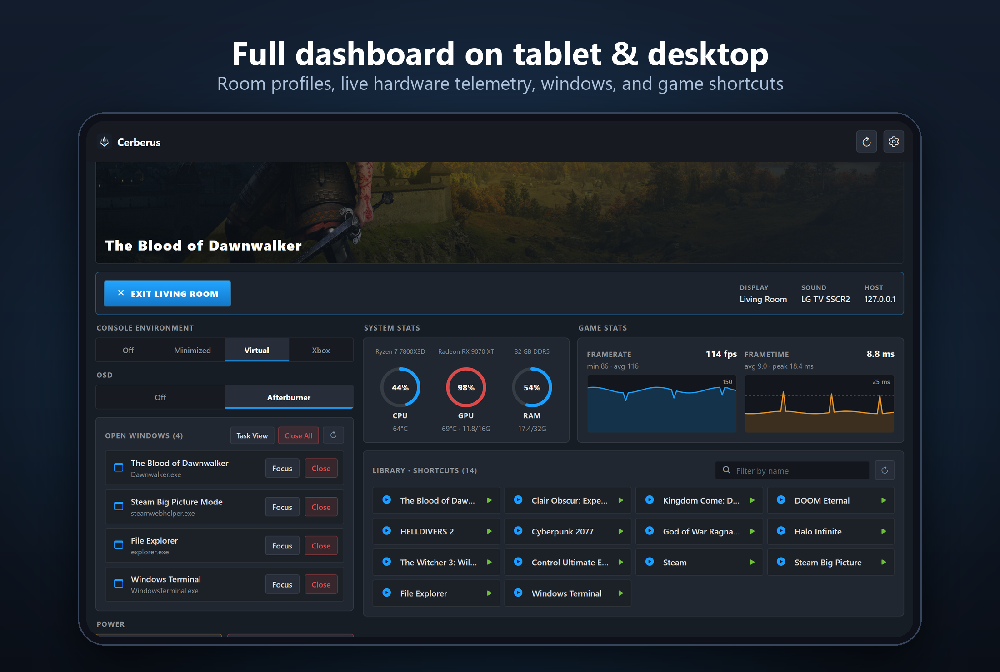
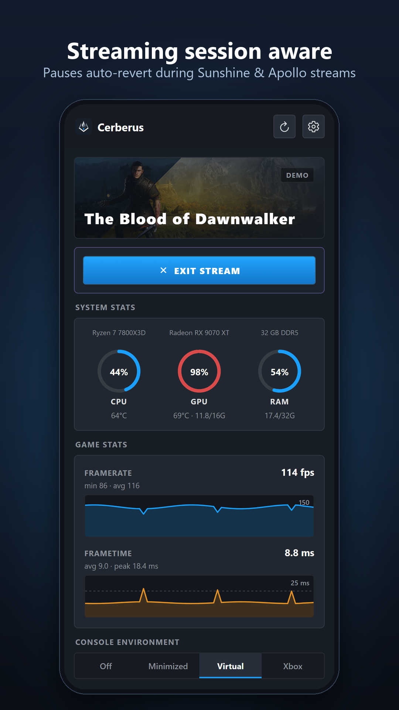
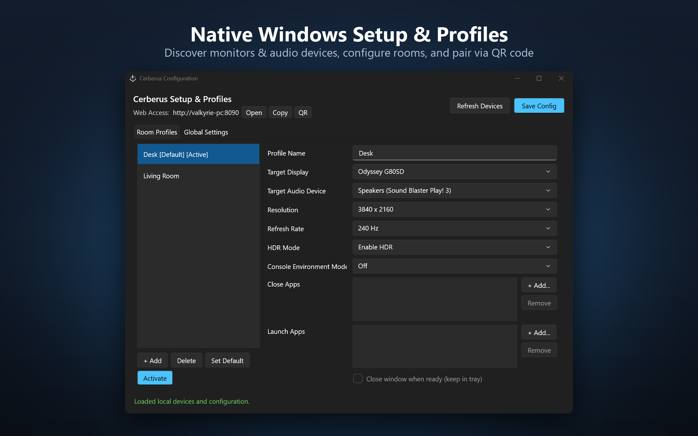

  

<h1 align="center">Cerberus</h1>

  
  
  
  

Cerberus is a remote that simplifies using a Windows gaming PC across multiple screens for a more console-like experience. It is primarily designed for advanced setups where displays from multiple rooms are plugged into the GPU, but also provides general remote control and monitoring functionality for single-room setups. Acting as a profile switcher and hardware dashboard, it lets you monitor live CPU, GPU, and FPS telemetry, toggle the RivaTuner Statistics Server (RTSS) On-Screen Display (OSD), launch games, manage open windows, and wake or sleep your PC from your phone or tablet without touching a keyboard or mouse.

Profiles work across any setup. Switch monitors, TVs, resolution, refresh rate, HDR, audio output, Steam Big Picture, and desktop cleanup modes between rooms, or toggle display presets on a single monitor. When you power on an Xbox controller, Cerberus can also trigger a profile switch. While you stream with Sunshine or Apollo, Cerberus detects active virtual-display sessions, triggers a profile you tailor to it, and lets you end a stream remotely.

  
  &nbsp;&nbsp;&nbsp;
  
  &nbsp;&nbsp;&nbsp;
  

---

## Download

Cerberus is currently in **alpha** (pre-release):

- **[Releases](https://github.com/cgarst/cerberus/releases)** — automated alpha builds from `master`, plus beta and stable releases

Each release includes:

Required PC service:
- **Windows**: `CerberusServiceSetup-*-win-x64.exe` (recommended installer) and `CerberusService-*-win-x64.exe` (standalone executable)

Optional mobile apps (can alternatively use web UI):
- **Android**: `Cerberus-*-android.apk` (also available via [Obtainium](https://obtainium.imranr.dev/): [add to Obtainium](https://apps.obtainium.imranr.dev/redirect?r=obtainium://add/https://github.com/cgarst/cerberus) and enable **Include prereleases**)
- **iOS**: `Cerberus-*-ios-unsigned.ipa` (also available via the [SideStore / AltStore source](https://raw.githubusercontent.com/cgarst/cerberus/altstore/source.json))

---

## Console environment modes

Three modes are provided to provide a more console-like environment to run before a launch command such as Steam Big Picture mode:

| Mode | Behavior |
| --- | --- |
| Virtual Desktop | Switches to a clean virtual desktop when activated and restores your previous desktop when you switch back |
| Xbox Mode | Opens the Windows Xbox Fullscreen Experience (`Win+F11`) and exits it when you switch back |
| Minimize All | Minimizes open desktop windows when activated |
| Off | Leaves desktop windows untouched |

---

## Game streaming interoperability

Cerberus works alongside Sunshine and Apollo so local room switching and remote game streaming stay out of each other's way. When a stream starts, Cerberus detects it automatically and pauses idle timers, wake guards, and Xbox controller triggers so your session isn't interrupted.

You can pick a dedicated GameStream console mode in the **Setup** UI (such as Virtual Desktop or Xbox Mode) to enter automatically when streaming begins and revert when it ends. Auto-detection works without extra setup, or you can trigger the mode immediately from Sunshine or Apollo Do/Undo commands using `POST /api/streaming/start` and `POST /api/streaming/end`.

While you play, your phone or tablet stays useful as a companion dashboard with live CPU/GPU/FPS telemetry, RTSS OSD toggling, window controls, and desktop shortcuts.

  

---

## Getting started

### Prerequisites

Before you install Cerberus, make sure you have:

- Windows 10 or Windows 11 PC with the [.NET 10 Desktop Runtime (x64)](https://dotnet.microsoft.com/download/dotnet/10.0)
- Any modern mobile or desktop browser for the web UI, or the native `CerberusExpo` app for Wake-on-LAN support
- [MSI Afterburner / RTSS](https://www.guru3d.com/download/msi-afterburner-beta-download/) (optional) for FPS, frametime, and remote OSD toggling
- [Sunshine](https://github.com/LizardByte/Sunshine) or Apollo (optional) for streaming session detection

### Install and run

To install and run Cerberus:

1. Download and run `CerberusServiceSetup-*-win-x64.exe` from [Releases](https://github.com/cgarst/cerberus/releases). The installer places the service in `Program Files\CerberusService`, stores `config.json` and `logs\` in `C:\ProgramData\CerberusService\`, and sets up the Windows Firewall rule, HTTP URL ACL, and optional logon autostart task.
2. Open **Setup & Profiles** from the Cerberus tray icon to configure your monitors and audio devices.
3. *(Optional)* Install the mobile app on Android (`Cerberus-*-android.apk` or via [Obtainium](https://obtainium.imranr.dev/): [add Cerberus](https://apps.obtainium.imranr.dev/redirect?r=obtainium://add/https://github.com/cgarst/cerberus)) or iOS (`Cerberus-*-ios-unsigned.ipa` / SideStore) for Wake-on-LAN and native app access, or open `http://<pc-name>:8090` in any browser.

---

## Usage

1. Open **Setup & Profiles** from the system tray on your PC. Cerberus detects connected displays (resolution, refresh rate, HDR) and audio playback devices so you can create profiles for different rooms, set up display or HDR presets on a single monitor, or keep one profile for remote control and telemetry without editing JSON by hand.
2. To open the remote UI on your phone, tablet, or another device, select **Open**, **Copy**, or **QR** next to the Web Access URL (`http://<pc-name>:8090`) in the **Setup** window.
3. Tap any profile in the remote UI. Cerberus checks that the target monitor is available, closes any configured background apps, applies your display, HDR, audio, and console environment settings, and launches Steam Big Picture or configured apps.
4. **Optional:** Turn on an Xbox controller connected through the USB Xbox Wireless Adapter (`USB\VID_045E&PID_02FE` / `02E6`) to switch to your chosen gaming profile automatically.
5. Use your phone or tablet as a second-screen companion: watch live CPU, AMD GPU, RAM, FPS, and frametime sparklines, toggle the RTSS OSD without alt-tabbing, focus or close windows, launch desktop shortcuts, and wake your PC with Wake-on-LAN, put it to sleep, or shut it down.

Cerberus reverts to your default profile before sleep, on wake if no activation request arrives within `WakeGuardSeconds`, and after `IdleRevertMinutes` of no mouse, keyboard, or gamepad input. All auto-revert timers and controller triggers pause while a Sunshine or Apollo stream is active.

  

---

## Development

See [DEVELOPMENT.md](DEVELOPMENT.md) for source layout, build and test commands, web UI export, demo mode, screenshot generation, and internal API details.
